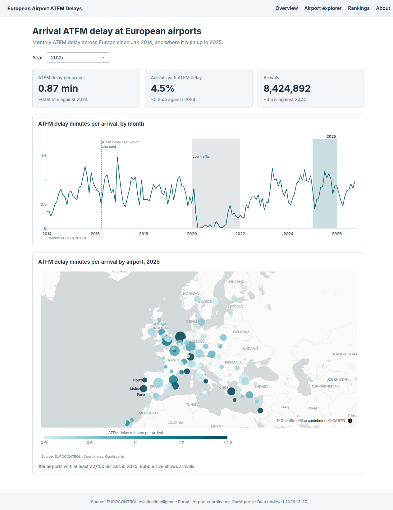
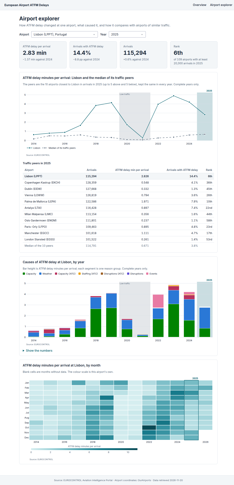
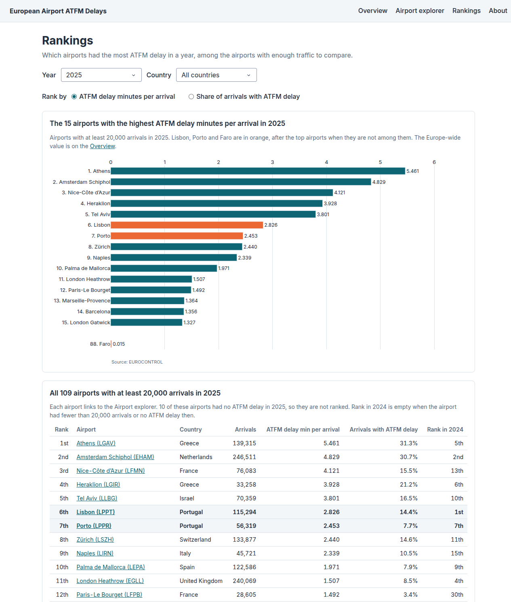

# European Airport ATFM Delays: Dashboard

Interactive dashboard of arrival ATFM delay at the airports EUROCONTROL reports, from January 2014 to the latest month published, with a focus on Lisbon, Porto and Faro. It builds on the analysis notebook [europe-airport-delays-analysis](https://github.com/BoualemP/europe-airport-delays-analysis), where the definitions and decisions used here are explained. Source: EUROCONTROL Aviation Intelligence Portal.

Live app: [europe-airport-delays.onrender.com](https://europe-airport-delays.onrender.com). It runs on free hosting: after 15 minutes without visits the service sleeps, and the next visit can take up to a minute to load.



## Screens

- Overview: Europe-wide ATFM delay for a selected year, the monthly trend since 2014, and a map of the airports with at least 20,000 arrivals.
- Airport explorer: one airport's ATFM delay by year, its causes by reason group, a month-by-month heatmap, and a comparison with airports of similar traffic.
- Rankings: airports ranked by ATFM delay minutes per arrival or by the share of arrivals with ATFM delay, by year and country.
- About: what ATFM delay is, the data, how the numbers are calculated, the limitations and the terms of use.

| Airport explorer | Rankings |
|---|---|
|  |  |

## How it works

- The app downloads the yearly EUROCONTROL files, reads them one at a time and aggregates each to one row per airport and month, checked against sums computed from the raw file. Airport coordinates come from OurAirports.
- In the Docker image this runs at build time, so start-up only reads the result. In a local test limited to 0.1 CPU, as on the free instance, the first response came after about 10 seconds instead of about a minute.
- Every value is a ratio of sums computed when the app runs. A partial year is compared with the same months of the previous year.
- pytest tests on synthetic files cover the reading, the checks, the metrics and the callback of every screen.

## Run locally

```
pip install -r requirements-dev.txt
pytest
python app.py
```

Or with Docker:

```
docker build -t airport-delays-dashboard .
docker run -p 8050:10000 airport-delays-dashboard
```

The first run downloads the data into `data/`. `REFRESH=1 python app.py` downloads it again; with Docker, rebuild without the cache (`docker build --no-cache`, or "Clear build cache & deploy" on Render).

## Tech stack

Python, Dash, Plotly, pandas, requests, gunicorn, pytest, Docker, Render.

## Project structure

```
europe-airport-delays-dashboard/
├── app.py               # Dash app, header and footer
├── pages/               # one page per screen: overview, airport, rankings, about
├── dashboard/
│   ├── data.py          # download, read, check and aggregate the EUROCONTROL files
│   ├── prepare.py       # build-time step of the Docker image
│   ├── metrics.py       # ratios, rankings, traffic peers, causes
│   ├── figures.py       # Plotly figures
│   ├── components.py    # KPI cards, tables, legends
│   └── overview.py, airport.py, rankings.py, about.py   # content of each screen
├── assets/              # style.css, map.js
├── tests/
├── docs/                # screenshots
├── Dockerfile
├── requirements.txt
├── requirements-dev.txt
└── LICENSE
```

## Data and licence

Data © EUROCONTROL, used under its terms: the source is named and there is no commercial use. The data is not stored in this repository. Code under the [MIT licence](LICENSE). © 2026 Boualem Pereira.

## Author

**Boualem Pereira**
